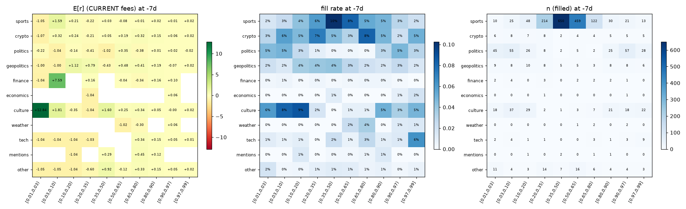
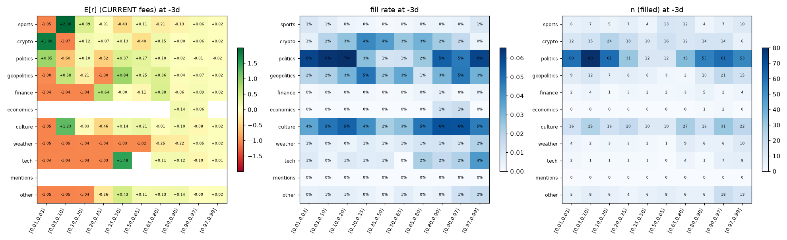
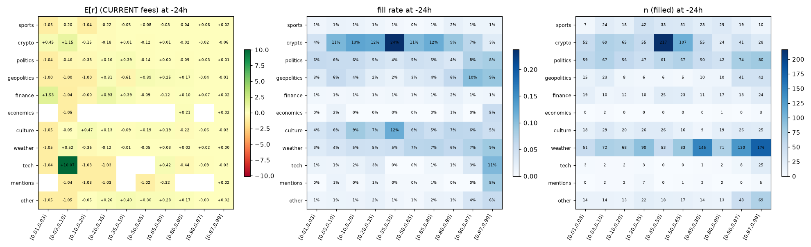
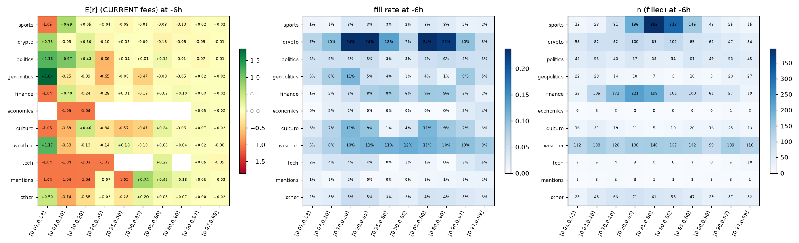
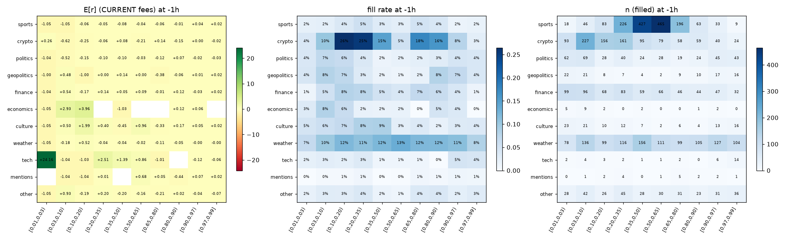
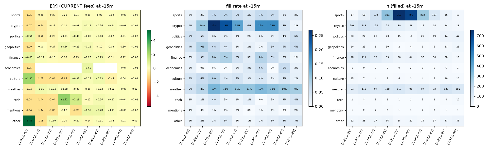

# S1 — executable calibration surface: discovery report

Generated 2026-09-15T20:13:52+00:00 by `tools/research/s1_calibration.py`.

**Disclaimer first.** Every number below is in-sample on the discovery set D. A cell that
passes the selection rule is a *candidate*, not a finding: it must clear C1 and C2 through
the engine (PRD v3 §6.2) before any other word applies. Cells below 300 filled
observations are underpowered and carry their MDE; nothing is selected from them.

Months: 2025-07, 2025-08, 2025-09, 2025-10, 2025-11, 2025-12, 2026-02, 2026-03, 2026-04, 2026-05. Observations: 1,851,402 (94,254 with an executable fill).
Register N (primary cells, `s1_calibration:cells`): 660. Cluster bootstrap: 10,000 resamples by event and by UTC day; the wider interval is shown.

## Verdict

**Candidates: none.** No primary cell cleared the pre-registered rule (BH 10% FDR across 660 register cells; 0 cells passed BH alone).

Excluded from primary cells as `ultra_short` (question window ≤ 60 min or end − open ≤ 60 min): 29,319 markets, 279,100 observations (59,840 with a fill). They are measured in `calibration_ultra_short.parquet`, never pooled.

## Coverage per offset

| Offset | observations | with mid | with fill | fill rate |
|---|---|---|---|---|
| -7d | 95,470 | 78,702 | 2,790 | 2.9% |
| -3d | 152,916 | 135,847 | 1,911 | 1.2% |
| -24h | 222,754 | 189,720 | 4,819 | 2.2% |
| -6h | 271,042 | 248,812 | 7,532 | 2.8% |
| -1h | 296,362 | 275,945 | 22,083 | 7.5% |
| -15m | 299,092 | 278,399 | 42,051 | 14.1% |

## Heatmaps (E[r], fill rate, n per offset)

## Negative space — every primary cell with data (n ≥ 30): what could have been missed

| Category | Bucket | Offset | n | fill rate | E[r] | 90% CI | E[r] first print | MDE@80% | mid cal. | months + | status |
|---|---|---|---|---|---|---|---|---|---|---|---|
| crypto | [0.01,0.03) | -15m | 106 | 4% | -1.069 | -1.069 to -1.069 | -106.5% | 0.000 | -1.7% | 0/6 / 0/4 | underpowered |
| crypto | [0.03,0.10) | -15m | 138 | 10% | -0.731 | -1.066 to -0.262 | -73.1% | 0.595 | -2.7% | 1/6 / 0/4 | underpowered |
| crypto | [0.10,0.20) | -15m | 115 | 27% | -0.274 | -0.601 to +0.103 | +14.8% | 0.529 | -0.6% | 2/6 / 2/4 | underpowered |
| crypto | [0.20,0.35) | -15m | 75 | 23% | -0.211 | -0.514 to +0.117 | -27.8% | 0.479 | -7.7% | 2/6 / 1/4 | underpowered |
| crypto | [0.35,0.50) | -15m | 69 | 15% | +0.078 | -0.162 to +0.316 | +31.8% | 0.359 | -20.9% | 3/6 / 3/4 | underpowered |
| crypto | [0.50,0.65) | -15m | 53 | 6% | +0.240 | +0.041 to +0.429 | +31.3% | 0.290 | +7.6% | 4/6 / 3/4 | underpowered |
| finance | [0.01,0.03) | -15m | 78 | 2% | +0.633 | -0.552 to +2.392 | +135.1% | 2.400 | -1.3% | 0/3 / 3/4 | underpowered |
| finance | [0.03,0.10) | -15m | 111 | 5% | +0.143 | -0.544 to +0.880 | +35.3% | 1.074 | -2.8% | 1/3 / 2/4 | underpowered |
| finance | [0.10,0.20) | -15m | 79 | 8% | -0.095 | -0.566 to +0.403 | -6.2% | 0.731 | -5.3% | 2/3 / 1/4 | underpowered |
| finance | [0.20,0.35) | -15m | 59 | 9% | -0.178 | -0.489 to +0.157 | -9.8% | 0.483 | -6.1% | 3/3 / 0/4 | underpowered |
| finance | [0.35,0.50) | -15m | 36 | 5% | -0.285 | -0.577 to +0.032 | -27.7% | 0.462 | -15.6% | 0/3 / 1/4 | underpowered |
| finance | [0.50,0.65) | -15m | 44 | 3% | +0.229 | +0.011 to +0.419 | +22.4% | 0.310 | +12.0% | 1/3 / 2/4 | underpowered |
| finance | [0.65,0.80) | -15m | 33 | 8% | +0.251 | +0.126 to +0.355 | +34.5% | 0.175 | +5.8% | 2/2 / 4/4 | underpowered |
| finance | [0.80,0.90) | -15m | 30 | 6% | -0.109 | -0.286 to +0.048 | -11.5% | 0.254 | +6.0% | 1/2 / 1/4 | underpowered |
| other | [0.20,0.35) | -15m | 36 | 3% | -0.203 | -0.624 to +0.294 | -22.7% | 0.693 | -6.7% | 2/6 / 1/2 | underpowered |
| other | [0.90,0.97) | -15m | 33 | 4% | -0.006 | -0.083 to +0.059 | -0.6% | 0.112 | +2.0% | 4/5 / 3/4 | underpowered |
| other | [0.97,0.99] | -15m | 43 | 3% | -0.007 | -0.055 to +0.018 | -0.7% | 0.061 | +0.5% | 5/6 / 4/4 | underpowered |
| politics | [0.01,0.03) | -15m | 33 | 5% | +0.556 | -1.039 to +3.745 | +40.7% | 3.982 | -0.2% | 1/5 / 0/4 | underpowered |
| politics | [0.90,0.97) | -15m | 44 | 4% | -0.013 | -0.089 to +0.042 | -0.8% | 0.103 | +2.4% | 3/4 / 2/4 | underpowered |
| politics | [0.97,0.99] | -15m | 47 | 6% | +0.019 | +0.017 to +0.020 | +1.9% | 0.002 | +0.3% | 5/5 / 4/4 | underpowered |
| sports | [0.03,0.10) | -15m | 60 | 3% | -0.282 | -0.856 to +0.434 | -14.6% | 0.972 | -2.9% | 2/6 / 1/4 | underpowered |
| sports | [0.10,0.20) | -15m | 150 | 7% | -0.370 | -0.638 to -0.076 | -36.8% | 0.421 | -2.7% | 1/6 / 1/4 | underpowered |
| sports | [0.20,0.35) | -15m | 314 | 7% | -0.214 | -0.357 to -0.067 | -21.0% | 0.218 | +0.2% | 0/6 / 1/4 | thin fills |
| sports | [0.35,0.50) | -15m | 759 | 6% | -0.015 | -0.081 to +0.053 | -1.5% | 0.101 | -3.1% | 3/6 / 0/4 | thin fills |
| sports | [0.50,0.65) | -15m | 700 | 4% | -0.047 | -0.103 to +0.008 | -4.7% | 0.084 | +2.2% | 1/6 / 0/4 | thin fills |
| sports | [0.65,0.80) | -15m | 283 | 7% | -0.071 | -0.137 to -0.006 | -7.2% | 0.099 | -0.3% | 2/6 / 1/4 | underpowered |
| sports | [0.80,0.90) | -15m | 107 | 6% | -0.023 | -0.096 to +0.045 | -2.3% | 0.108 | +1.7% | 2/6 / 2/4 | underpowered |
| sports | [0.90,0.97) | -15m | 46 | 3% | +0.050 | +0.003 to +0.077 | +5.0% | 0.058 | +3.9% | 4/5 / 4/4 | underpowered |
| weather | [0.01,0.03) | -15m | 84 | 5% | -0.538 | -1.049 to +0.487 | -75.2% | 1.268 | -0.3% | 0/6 / 1/4 | underpowered |
| weather | [0.03,0.10) | -15m | 110 | 8% | +0.358 | -0.361 to +1.186 | +41.7% | 1.166 | -1.2% | 4/6 / 1/4 | underpowered |
| weather | [0.10,0.20) | -15m | 97 | 12% | +0.239 | -0.218 to +0.728 | +28.3% | 0.715 | -2.6% | 4/6 / 2/4 | underpowered |
| weather | [0.20,0.35) | -15m | 110 | 11% | +0.081 | -0.194 to +0.368 | +10.3% | 0.424 | -1.2% | 3/6 / 2/4 | underpowered |
| weather | [0.35,0.50) | -15m | 117 | 11% | +0.025 | -0.169 to +0.210 | +1.6% | 0.286 | -1.8% | 2/6 / 2/4 | underpowered |
| weather | [0.50,0.65) | -15m | 91 | 11% | -0.053 | -0.207 to +0.098 | -5.4% | 0.231 | +1.6% | 2/6 / 2/4 | underpowered |
| weather | [0.65,0.80) | -15m | 97 | 12% | +0.033 | -0.077 to +0.142 | +3.5% | 0.165 | +1.4% | 4/6 / 2/4 | underpowered |
| weather | [0.80,0.90) | -15m | 72 | 11% | +0.016 | -0.069 to +0.088 | +1.7% | 0.119 | +2.6% | 4/5 / 3/4 | underpowered |
| weather | [0.90,0.97) | -15m | 132 | 10% | +0.045 | +0.024 to +0.062 | +4.5% | 0.028 | +1.0% | 5/6 / 4/4 | underpowered |
| weather | [0.97,0.99] | -15m | 109 | 9% | -0.020 | -0.054 to +0.008 | -2.0% | 0.046 | +0.4% | 4/6 / 2/4 | underpowered |
| crypto | [0.01,0.03) | -1h | 93 | 4% | +0.263 | -1.069 to +2.055 | +18.2% | 2.419 | -1.1% | 0/6 / 1/4 | underpowered |
| crypto | [0.03,0.10) | -1h | 227 | 10% | -0.622 | -0.912 to -0.241 | -56.0% | 0.516 | -1.1% | 2/6 / 0/4 | underpowered |
| crypto | [0.10,0.20) | -1h | 156 | 26% | -0.249 | -0.571 to +0.101 | -19.2% | 0.508 | -0.8% | 4/6 / 0/4 | underpowered |
| crypto | [0.20,0.35) | -1h | 161 | 25% | -0.064 | -0.280 to +0.152 | -2.8% | 0.324 | -6.2% | 1/6 / 2/4 | underpowered |
| crypto | [0.35,0.50) | -1h | 95 | 15% | +0.082 | -0.102 to +0.270 | +9.2% | 0.281 | -19.0% | 4/6 / 3/4 | underpowered |
| crypto | [0.50,0.65) | -1h | 79 | 5% | -0.210 | -0.391 to -0.033 | -21.6% | 0.270 | +7.3% | 1/6 / 2/4 | underpowered |
| crypto | [0.65,0.80) | -1h | 58 | 18% | +0.139 | +0.025 to +0.240 | +19.2% | 0.163 | +7.3% | 5/6 / 4/4 | underpowered |
| crypto | [0.80,0.90) | -1h | 59 | 16% | -0.149 | -0.269 to -0.033 | -14.9% | 0.176 | +0.8% | 2/6 / 1/4 | underpowered |
| crypto | [0.90,0.97) | -1h | 40 | 8% | +0.004 | -0.061 to +0.058 | +0.2% | 0.090 | +1.1% | 4/6 / 4/4 | underpowered |
| finance | [0.01,0.03) | -1h | 99 | 1% | -1.039 | -1.040 to -1.039 | -103.8% | 0.000 | -1.5% | 0/3 / 0/4 | underpowered |
| finance | [0.03,0.10) | -1h | 96 | 5% | +0.536 | -0.293 to +1.483 | +60.0% | 1.352 | -2.9% | 1/3 / 3/4 | underpowered |
| finance | [0.10,0.20) | -1h | 68 | 8% | -0.172 | -0.658 to +0.351 | -24.7% | 0.759 | -4.9% | 2/3 / 0/4 | underpowered |
| finance | [0.20,0.35) | -1h | 83 | 8% | +0.141 | -0.191 to +0.480 | +35.1% | 0.503 | -6.0% | 2/3 / 3/4 | underpowered |
| finance | [0.35,0.50) | -1h | 59 | 5% | +0.055 | -0.215 to +0.321 | +18.2% | 0.401 | -15.0% | 2/3 / 3/4 | underpowered |
| finance | [0.50,0.65) | -1h | 66 | 4% | +0.090 | -0.090 to +0.280 | +10.9% | 0.283 | +11.1% | 1/3 / 3/4 | underpowered |
| finance | [0.65,0.80) | -1h | 46 | 7% | -0.014 | -0.175 to +0.139 | +2.5% | 0.237 | +5.2% | 1/3 / 2/4 | underpowered |
| finance | [0.80,0.90) | -1h | 44 | 6% | +0.121 | +0.049 to +0.176 | +12.3% | 0.097 | +5.5% | 1/2 / 4/4 | underpowered |
| finance | [0.90,0.97) | -1h | 47 | 4% | -0.035 | -0.114 to +0.033 | -3.4% | 0.111 | +3.1% | 2/3 / 1/4 | underpowered |
| finance | [0.97,0.99] | -1h | 32 | 1% | +0.018 | +0.016 to +0.020 | +1.8% | 0.003 | +1.5% | 2/2 / 4/4 | underpowered |
| other | [0.03,0.10) | -1h | 42 | 3% | +0.929 | -0.534 to +2.828 | +92.9% | 2.572 | -1.7% | 2/6 / 1/3 | underpowered |
| other | [0.20,0.35) | -1h | 45 | 4% | +0.202 | -0.311 to +0.730 | +32.0% | 0.789 | -5.3% | 2/6 / 1/2 | underpowered |
| other | [0.50,0.65) | -1h | 30 | 1% | -0.161 | -0.441 to +0.119 | -16.8% | 0.421 | +7.9% | 1/4 / 1/3 | underpowered |
| other | [0.65,0.80) | -1h | 31 | 4% | -0.212 | -0.412 to -0.017 | -22.1% | 0.297 | +5.3% | 2/6 / 1/3 | underpowered |
| other | [0.90,0.97) | -1h | 31 | 2% | -0.044 | -0.148 to +0.034 | -4.4% | 0.142 | +2.3% | 3/5 / 3/4 | underpowered |
| other | [0.97,0.99] | -1h | 36 | 3% | -0.068 | -0.167 to -0.007 | -6.8% | 0.130 | +0.4% | 4/5 / 1/3 | underpowered |
| politics | [0.01,0.03) | -1h | 62 | 4% | -1.039 | -1.039 to -1.039 | -104.0% | 0.000 | -0.3% | 0/6 / 0/4 | underpowered |
| politics | [0.03,0.10) | -1h | 69 | 7% | -0.516 | -0.892 to +0.053 | -52.0% | 0.767 | -1.5% | 0/6 / 2/4 | underpowered |
| politics | [0.20,0.35) | -1h | 40 | 4% | -0.101 | -0.537 to +0.396 | -6.0% | 0.711 | -3.1% | 2/4 / 2/4 | underpowered |
| politics | [0.90,0.97) | -1h | 45 | 4% | -0.025 | -0.109 to +0.045 | -2.5% | 0.116 | +1.6% | 5/5 / 1/4 | underpowered |
| politics | [0.97,0.99] | -1h | 43 | 4% | -0.029 | -0.083 to +0.019 | -2.9% | 0.078 | +0.4% | 5/6 / 3/4 | underpowered |
| sports | [0.03,0.10) | -1h | 46 | 2% | -1.047 | -1.047 to -1.047 | -105.2% | 0.000 | -3.1% | 0/6 / 0/4 | underpowered |
| sports | [0.10,0.20) | -1h | 83 | 4% | -0.059 | -0.463 to +0.371 | -5.8% | 0.625 | -2.7% | 2/6 / 1/4 | underpowered |
| sports | [0.20,0.35) | -1h | 226 | 5% | -0.054 | -0.226 to +0.120 | -5.1% | 0.260 | +0.1% | 5/6 / 1/4 | underpowered |
| sports | [0.35,0.50) | -1h | 427 | 3% | -0.078 | -0.173 to +0.017 | -7.8% | 0.142 | -3.1% | 3/6 / 1/4 | thin fills |
| sports | [0.50,0.65) | -1h | 465 | 3% | -0.038 | -0.110 to +0.032 | -3.9% | 0.107 | +2.1% | 1/6 / 2/4 | thin fills |
| sports | [0.65,0.80) | -1h | 196 | 5% | -0.060 | -0.138 to +0.018 | -6.0% | 0.118 | -0.0% | 2/6 / 1/4 | underpowered |
| sports | [0.80,0.90) | -1h | 63 | 4% | -0.009 | -0.107 to +0.085 | -0.9% | 0.143 | +1.4% | 3/6 / 2/4 | underpowered |
| sports | [0.90,0.97) | -1h | 33 | 2% | +0.037 | -0.028 to +0.074 | +3.8% | 0.081 | +4.1% | 5/5 / 3/4 | underpowered |
| weather | [0.01,0.03) | -1h | 78 | 7% | -1.049 | -1.049 to -1.049 | -104.9% | 0.000 | -0.2% | 0/6 / 0/4 | underpowered |
| weather | [0.03,0.10) | -1h | 136 | 10% | -0.183 | -0.730 to +0.444 | -21.1% | 0.889 | -0.9% | 3/6 / 0/4 | underpowered |
| weather | [0.10,0.20) | -1h | 99 | 12% | +0.524 | +0.051 to +1.048 | +47.5% | 0.751 | -3.0% | 3/5 / 3/4 | underpowered |
| weather | [0.20,0.35) | -1h | 116 | 11% | -0.037 | -0.276 to +0.205 | -3.8% | 0.366 | -1.2% | 3/5 / 2/4 | underpowered |
| weather | [0.35,0.50) | -1h | 156 | 12% | -0.043 | -0.201 to +0.111 | -5.5% | 0.234 | +0.4% | 4/6 / 2/4 | underpowered |
| weather | [0.50,0.65) | -1h | 111 | 13% | -0.024 | -0.159 to +0.109 | -0.6% | 0.201 | -0.3% | 1/6 / 2/4 | underpowered |
| weather | [0.65,0.80) | -1h | 99 | 12% | -0.109 | -0.227 to +0.004 | -10.7% | 0.174 | +1.3% | 1/4 / 1/4 | underpowered |
| weather | [0.80,0.90) | -1h | 105 | 12% | -0.047 | -0.120 to +0.021 | -4.7% | 0.106 | +2.8% | 2/5 / 0/4 | underpowered |
| weather | [0.90,0.97) | -1h | 127 | 11% | -0.004 | -0.045 to +0.031 | -0.2% | 0.057 | +0.9% | 4/6 / 2/4 | underpowered |
| weather | [0.97,0.99] | -1h | 104 | 8% | -0.003 | -0.031 to +0.017 | -0.3% | 0.034 | +0.2% | 3/4 / 3/4 | underpowered |
| crypto | [0.01,0.03) | -24h | 52 | 4% | +0.446 | -1.069 to +2.682 | +3.6% | 3.101 | -1.0% | 0/6 / 1/4 | underpowered |
| crypto | [0.03,0.10) | -24h | 69 | 11% | +1.147 | -0.676 to +3.249 | +107.0% | 2.958 | -1.4% | 2/6 / 2/4 | underpowered |
| crypto | [0.10,0.20) | -24h | 65 | 13% | -0.152 | -0.595 to +0.321 | -15.8% | 0.697 | +4.3% | 3/6 / 1/4 | underpowered |
| crypto | [0.20,0.35) | -24h | 55 | 12% | -0.179 | -0.563 to +0.241 | -19.3% | 0.610 | +0.2% | 1/6 / 1/3 | underpowered |
| crypto | [0.35,0.50) | -24h | 217 | 24% | +0.008 | -0.110 to +0.124 | +0.3% | 0.177 | -3.3% | 3/6 / 1/4 | underpowered |
| crypto | [0.50,0.65) | -24h | 107 | 11% | -0.120 | -0.278 to +0.032 | -11.8% | 0.236 | +1.2% | 1/6 / 2/4 | underpowered |
| crypto | [0.65,0.80) | -24h | 55 | 12% | +0.011 | -0.139 to +0.148 | +1.1% | 0.217 | -0.5% | 4/6 / 3/4 | underpowered |
| crypto | [0.90,0.97) | -24h | 41 | 7% | -0.018 | -0.097 to +0.040 | -1.8% | 0.108 | +1.4% | 4/6 / 2/3 | underpowered |
| geopolitics | [0.90,0.97) | -24h | 41 | 10% | -0.041 | -0.148 to +0.064 | -4.1% | 0.162 | -0.3% | 6/6 / 2/4 | underpowered |
| geopolitics | [0.97,0.99] | -24h | 42 | 9% | -0.007 | -0.055 to +0.019 | -0.7% | 0.060 | -0.1% | 4/4 / 3/4 | underpowered |
| other | [0.90,0.97) | -24h | 48 | 4% | -0.005 | -0.078 to +0.047 | -0.5% | 0.099 | +2.5% | 4/5 / 2/3 | underpowered |
| other | [0.97,0.99] | -24h | 69 | 6% | +0.015 | +0.014 to +0.017 | +1.5% | 0.002 | +1.3% | 4/4 / 4/4 | underpowered |
| politics | [0.01,0.03) | -24h | 59 | 6% | -1.039 | -1.039 to -1.039 | -103.9% | 0.000 | -1.2% | 0/6 / 0/4 | underpowered |
| politics | [0.03,0.10) | -24h | 67 | 6% | -0.459 | -0.881 to +0.130 | -43.6% | 0.803 | -1.2% | 0/5 / 1/4 | underpowered |
| politics | [0.10,0.20) | -24h | 56 | 6% | -0.378 | -0.794 to +0.122 | -38.8% | 0.699 | -4.7% | 2/6 / 1/4 | underpowered |
| politics | [0.20,0.35) | -24h | 47 | 5% | +0.164 | -0.245 to +0.595 | +19.6% | 0.637 | -3.1% | 1/5 / 3/4 | underpowered |
| politics | [0.35,0.50) | -24h | 61 | 4% | +0.387 | +0.128 to +0.641 | +38.8% | 0.387 | -4.5% | 4/6 / 3/4 | underpowered |
| politics | [0.50,0.65) | -24h | 67 | 5% | -0.135 | -0.337 to +0.043 | -13.4% | 0.285 | +4.3% | 2/6 / 1/3 | underpowered |
| politics | [0.65,0.80) | -24h | 50 | 5% | +0.005 | -0.148 to +0.148 | +0.5% | 0.223 | +2.9% | 4/5 / 2/4 | underpowered |
| politics | [0.80,0.90) | -24h | 42 | 4% | -0.089 | -0.226 to +0.027 | -9.0% | 0.192 | +4.3% | 1/3 / 2/4 | underpowered |
| politics | [0.90,0.97) | -24h | 74 | 8% | +0.031 | -0.004 to +0.061 | +3.0% | 0.051 | +1.6% | 6/6 / 3/4 | underpowered |
| politics | [0.97,0.99] | -24h | 80 | 8% | +0.005 | -0.021 to +0.019 | +0.5% | 0.032 | +1.2% | 6/6 / 3/4 | underpowered |
| sports | [0.20,0.35) | -24h | 42 | 1% | -0.221 | -0.594 to +0.190 | -22.0% | 0.593 | -0.7% | 2/6 / 3/4 | underpowered |
| sports | [0.35,0.50) | -24h | 33 | 1% | -0.051 | -0.351 to +0.268 | -5.5% | 0.467 | -2.6% | 3/5 / 1/4 | underpowered |
| sports | [0.50,0.65) | -24h | 31 | 0% | +0.075 | -0.165 to +0.320 | +7.5% | 0.368 | +1.6% | 3/6 / 3/4 | underpowered |
| weather | [0.01,0.03) | -24h | 51 | 3% | -1.049 | -1.049 to -1.049 | -104.9% | 0.000 | -0.1% | 0/3 / 0/4 | underpowered |
| weather | [0.03,0.10) | -24h | 72 | 4% | +0.525 | -0.421 to +1.593 | +52.5% | 1.527 | -1.6% | 1/4 / 2/4 | underpowered |
| weather | [0.10,0.20) | -24h | 68 | 5% | -0.359 | -0.772 to +0.119 | -37.0% | 0.670 | -4.4% | 0/0 / 0/4 | underpowered |
| weather | [0.20,0.35) | -24h | 90 | 5% | -0.116 | -0.385 to +0.158 | -11.2% | 0.411 | -3.2% | 0/0 / 1/4 | underpowered |
| weather | [0.35,0.50) | -24h | 53 | 5% | -0.010 | -0.281 to +0.278 | -0.8% | 0.422 | -3.3% | 0/2 / 3/4 | underpowered |
| weather | [0.50,0.65) | -24h | 83 | 7% | -0.054 | -0.210 to +0.095 | -5.5% | 0.231 | +3.4% | 0/0 / 3/4 | underpowered |
| weather | [0.65,0.80) | -24h | 145 | 7% | +0.027 | -0.055 to +0.107 | +2.8% | 0.123 | +2.8% | 1/1 / 3/4 | underpowered |
| weather | [0.80,0.90) | -24h | 71 | 6% | +0.020 | -0.062 to +0.093 | +2.0% | 0.117 | +4.5% | 0/1 / 2/4 | underpowered |
| weather | [0.90,0.97) | -24h | 130 | 7% | +0.021 | -0.012 to +0.048 | +2.1% | 0.046 | +1.6% | 1/2 / 3/4 | underpowered |
| weather | [0.97,0.99] | -24h | 176 | 9% | +0.004 | -0.010 to +0.015 | +0.4% | 0.019 | +0.2% | 3/3 / 3/4 | underpowered |
| culture | [0.90,0.97) | -3d | 31 | 6% | -0.083 | -0.182 to +0.014 | -8.3% | 0.144 | +1.5% | 0/0 / 0/2 | underpowered |
| politics | [0.01,0.03) | -3d | 60 | 6% | +0.847 | -1.039 to +3.526 | +83.8% | 3.575 | -0.9% | 1/6 / 1/3 | underpowered |
| politics | [0.03,0.10) | -3d | 80 | 6% | -0.600 | -0.911 to -0.163 | -60.0% | 0.604 | -0.9% | 2/6 / 0/4 | underpowered |
| politics | [0.10,0.20) | -3d | 61 | 7% | +0.102 | -0.434 to +0.698 | +11.0% | 0.863 | -3.1% | 2/5 / 2/3 | underpowered |
| politics | [0.20,0.35) | -3d | 31 | 3% | -0.515 | -0.898 to -0.102 | -51.5% | 0.584 | -3.8% | 0/5 / 1/4 | underpowered |
| politics | [0.65,0.80) | -3d | 35 | 2% | +0.102 | -0.055 to +0.237 | +10.1% | 0.220 | +3.7% | 2/5 / 2/2 | underpowered |
| politics | [0.80,0.90) | -3d | 55 | 5% | +0.021 | -0.059 to +0.099 | +2.1% | 0.118 | +3.4% | 3/5 / 3/4 | underpowered |
| politics | [0.90,0.97) | -3d | 61 | 5% | -0.013 | -0.073 to +0.039 | -1.3% | 0.084 | +1.0% | 2/4 / 2/4 | underpowered |
| politics | [0.97,0.99] | -3d | 53 | 6% | -0.021 | -0.073 to +0.018 | -2.1% | 0.068 | +0.9% | 4/5 / 3/4 | underpowered |
| crypto | [0.01,0.03) | -6h | 58 | 7% | +0.751 | -1.069 to +2.993 | +75.1% | 3.192 | -1.2% | 1/6 / 1/4 | underpowered |
| crypto | [0.03,0.10) | -6h | 82 | 10% | -0.025 | -0.840 to +0.969 | +4.3% | 1.360 | -0.7% | 2/6 / 2/4 | underpowered |
| crypto | [0.10,0.20) | -6h | 82 | 24% | +0.302 | -0.225 to +0.887 | +27.5% | 0.842 | +0.6% | 3/6 / 2/4 | underpowered |
| crypto | [0.20,0.35) | -6h | 100 | 24% | -0.096 | -0.367 to +0.189 | -10.0% | 0.421 | +1.9% | 3/6 / 2/4 | underpowered |
| crypto | [0.35,0.50) | -6h | 85 | 13% | +0.021 | -0.217 to +0.270 | +1.2% | 0.366 | -0.4% | 4/6 / 2/4 | underpowered |
| crypto | [0.50,0.65) | -6h | 101 | 7% | -0.000 | -0.134 to +0.139 | -0.5% | 0.205 | +0.2% | 4/6 / 1/4 | underpowered |
| crypto | [0.65,0.80) | -6h | 65 | 24% | -0.130 | -0.283 to +0.020 | -13.0% | 0.229 | -1.7% | 1/6 / 2/3 | underpowered |
| crypto | [0.80,0.90) | -6h | 61 | 23% | -0.057 | -0.163 to +0.040 | -5.7% | 0.153 | -1.0% | 2/6 / 2/3 | underpowered |
| crypto | [0.90,0.97) | -6h | 47 | 10% | -0.053 | -0.152 to +0.035 | -5.4% | 0.139 | +0.4% | 4/6 / 3/3 | underpowered |
| crypto | [0.97,0.99] | -6h | 34 | 5% | -0.013 | -0.073 to +0.018 | -1.3% | 0.074 | +1.2% | 5/6 / 3/3 | underpowered |
| culture | [0.03,0.10) | -6h | 31 | 7% | -0.689 | -1.047 to +0.064 | -68.8% | 0.910 | +0.2% | 0/1 / 0/2 | underpowered |
| finance | [0.03,0.10) | -6h | 105 | 2% | +0.400 | -0.537 to +1.541 | +46.3% | 1.572 | -1.9% | 2/3 / 2/4 | underpowered |
| finance | [0.10,0.20) | -6h | 171 | 5% | -0.237 | -0.536 to +0.100 | -19.5% | 0.481 | -0.2% | 2/3 / 2/4 | underpowered |
| finance | [0.20,0.35) | -6h | 221 | 8% | -0.282 | -0.452 to -0.096 | -26.8% | 0.269 | -1.3% | 1/3 / 1/4 | underpowered |
| finance | [0.35,0.50) | -6h | 199 | 8% | +0.006 | -0.154 to +0.171 | +3.0% | 0.246 | -7.5% | 1/3 / 3/4 | underpowered |
| finance | [0.50,0.65) | -6h | 101 | 6% | -0.179 | -0.331 to -0.017 | -16.7% | 0.235 | +5.3% | 0/3 / 0/4 | underpowered |
| finance | [0.65,0.80) | -6h | 100 | 9% | +0.028 | -0.111 to +0.154 | +3.1% | 0.200 | +1.1% | 2/3 / 3/4 | underpowered |
| finance | [0.80,0.90) | -6h | 61 | 9% | +0.098 | +0.029 to +0.155 | +10.2% | 0.095 | +0.9% | 3/3 / 3/4 | underpowered |
| finance | [0.90,0.97) | -6h | 57 | 5% | +0.033 | -0.017 to +0.071 | +3.3% | 0.068 | +1.6% | 3/3 / 3/4 | underpowered |
| other | [0.03,0.10) | -6h | 48 | 3% | -0.740 | -1.047 to -0.128 | -74.2% | 0.765 | -1.4% | 1/6 / 0/3 | underpowered |
| other | [0.10,0.20) | -6h | 63 | 5% | -0.376 | -0.838 to +0.148 | -40.4% | 0.749 | -4.5% | 0/6 / 1/3 | underpowered |
| other | [0.20,0.35) | -6h | 71 | 5% | +0.019 | -0.299 to +0.357 | -2.5% | 0.496 | -3.8% | 2/6 / 1/3 | underpowered |
| other | [0.35,0.50) | -6h | 61 | 3% | -0.283 | -0.524 to -0.029 | -27.8% | 0.373 | -7.7% | 2/6 / 1/3 | underpowered |
| other | [0.50,0.65) | -6h | 56 | 2% | +0.198 | +0.022 to +0.374 | +19.0% | 0.267 | +5.3% | 4/6 / 2/3 | underpowered |
| other | [0.65,0.80) | -6h | 47 | 4% | +0.034 | -0.122 to +0.170 | +3.4% | 0.222 | +4.1% | 2/5 / 2/3 | underpowered |
| other | [0.90,0.97) | -6h | 37 | 3% | +0.004 | -0.083 to +0.064 | +0.5% | 0.109 | +1.7% | 6/6 / 2/4 | underpowered |
| other | [0.97,0.99] | -6h | 32 | 3% | +0.017 | +0.016 to +0.019 | +1.8% | 0.002 | +0.5% | 6/6 / 3/3 | underpowered |
| politics | [0.01,0.03) | -6h | 45 | 5% | +1.183 | -1.039 to +5.635 | +118.3% | 5.527 | +0.0% | 0/5 / 1/4 | underpowered |
| politics | [0.03,0.10) | -6h | 55 | 5% | +0.971 | -0.796 to +3.317 | +98.1% | 3.229 | -2.1% | 2/5 / 1/4 | underpowered |
| politics | [0.10,0.20) | -6h | 43 | 5% | +0.434 | -0.416 to +1.405 | +48.5% | 1.374 | -3.1% | 1/5 / 2/4 | underpowered |
| politics | [0.20,0.35) | -6h | 57 | 5% | -0.663 | -0.894 to -0.378 | -65.2% | 0.392 | -4.5% | 0/6 / 1/4 | underpowered |
| politics | [0.35,0.50) | -6h | 38 | 3% | +0.041 | -0.277 to +0.395 | +3.6% | 0.502 | -3.2% | 4/6 / 2/4 | underpowered |
| politics | [0.50,0.65) | -6h | 34 | 3% | +0.005 | -0.279 to +0.271 | +0.8% | 0.416 | +3.3% | 2/6 / 2/3 | underpowered |
| politics | [0.65,0.80) | -6h | 61 | 5% | +0.134 | -0.006 to +0.252 | +13.3% | 0.194 | +4.1% | 4/4 / 2/4 | underpowered |
| politics | [0.80,0.90) | -6h | 49 | 6% | -0.006 | -0.117 to +0.088 | -0.5% | 0.154 | +3.7% | 4/6 / 2/3 | underpowered |
| politics | [0.90,0.97) | -6h | 53 | 5% | -0.065 | -0.159 to +0.015 | -6.5% | 0.131 | +2.1% | 3/6 / 2/4 | underpowered |
| politics | [0.97,0.99] | -6h | 45 | 5% | -0.005 | -0.050 to +0.018 | -0.5% | 0.055 | +0.0% | 6/6 / 3/4 | underpowered |
| sports | [0.10,0.20) | -6h | 81 | 3% | +0.052 | -0.404 to +0.554 | -0.5% | 0.723 | -2.0% | 3/6 / 2/4 | underpowered |
| sports | [0.20,0.35) | -6h | 196 | 3% | +0.037 | -0.168 to +0.251 | +2.3% | 0.313 | -0.3% | 4/6 / 3/4 | underpowered |
| sports | [0.35,0.50) | -6h | 395 | 3% | -0.086 | -0.176 to +0.009 | -9.2% | 0.140 | -1.0% | 2/6 / 0/4 | thin fills |
| sports | [0.50,0.65) | -6h | 313 | 2% | -0.012 | -0.099 to +0.072 | -1.3% | 0.129 | +0.7% | 2/6 / 2/4 | thin fills |
| sports | [0.65,0.80) | -6h | 146 | 3% | -0.034 | -0.122 to +0.050 | -3.5% | 0.130 | +0.0% | 1/6 / 3/4 | underpowered |
| sports | [0.80,0.90) | -6h | 43 | 3% | -0.096 | -0.230 to +0.025 | -9.8% | 0.194 | +2.4% | 2/5 / 1/4 | underpowered |
| weather | [0.01,0.03) | -6h | 112 | 5% | +1.170 | -0.596 to +3.418 | +127.2% | 3.105 | -0.3% | 0/4 / 1/4 | underpowered |
| weather | [0.03,0.10) | -6h | 138 | 8% | -0.575 | -0.954 to -0.127 | -55.7% | 0.612 | -1.0% | 1/4 / 0/4 | underpowered |
| weather | [0.10,0.20) | -6h | 120 | 10% | -0.135 | -0.491 to +0.255 | -11.5% | 0.563 | -3.6% | 1/2 / 2/4 | underpowered |
| weather | [0.20,0.35) | -6h | 136 | 11% | -0.139 | -0.358 to +0.089 | -13.9% | 0.337 | -1.9% | 0/4 / 1/4 | underpowered |
| weather | [0.35,0.50) | -6h | 140 | 11% | +0.179 | +0.018 to +0.341 | +17.9% | 0.243 | -1.7% | 0/5 / 4/4 | underpowered |
| weather | [0.50,0.65) | -6h | 137 | 12% | -0.102 | -0.224 to +0.028 | -8.8% | 0.187 | +1.5% | 4/6 / 2/4 | underpowered |
| weather | [0.65,0.80) | -6h | 132 | 11% | +0.033 | -0.053 to +0.118 | +4.1% | 0.130 | +2.1% | 2/4 / 3/4 | underpowered |
| weather | [0.80,0.90) | -6h | 99 | 10% | +0.045 | -0.016 to +0.100 | +4.6% | 0.088 | +3.5% | 2/2 / 4/4 | underpowered |
| weather | [0.90,0.97) | -6h | 139 | 10% | +0.024 | -0.007 to +0.049 | +2.4% | 0.042 | +1.1% | 3/3 / 3/4 | underpowered |
| weather | [0.97,0.99] | -6h | 116 | 9% | -0.001 | -0.026 to +0.017 | -0.1% | 0.031 | +0.4% | 5/6 / 3/4 | underpowered |
| culture | [0.03,0.10) | -7d | 37 | 8% | +1.809 | +0.200 to +3.421 | +197.0% | 2.421 | -0.8% | 0/0 / 2/2 | underpowered |
| politics | [0.01,0.03) | -7d | 45 | 5% | -0.216 | -1.039 to +1.057 | -21.7% | 1.759 | -1.0% | 1/5 / 0/3 | underpowered |
| politics | [0.03,0.10) | -7d | 55 | 5% | -1.038 | -1.038 to -1.038 | -103.8% | 0.000 | -1.1% | 0/4 / 0/4 | underpowered |
| politics | [0.90,0.97) | -7d | 57 | 5% | +0.025 | -0.018 to +0.061 | +2.5% | 0.060 | +1.3% | 3/4 / 3/3 | underpowered |
| sports | [0.10,0.20) | -7d | 48 | 4% | +0.207 | -0.365 to +0.820 | +17.6% | 0.889 | -2.7% | 3/6 / 3/4 | underpowered |
| sports | [0.20,0.35) | -7d | 214 | 6% | -0.218 | -0.388 to -0.046 | -21.8% | 0.257 | -2.1% | 2/6 / 1/4 | underpowered |
| sports | [0.35,0.50) | -7d | 650 | 10% | +0.027 | -0.045 to +0.099 | +0.5% | 0.108 | -2.6% | 2/6 / 3/4 | thin fills |
| sports | [0.50,0.65) | -7d | 459 | 8% | -0.084 | -0.155 to -0.013 | -9.1% | 0.108 | +2.1% | 3/6 / 1/4 | thin fills |
| sports | [0.65,0.80) | -7d | 122 | 5% | +0.011 | -0.096 to +0.115 | +1.2% | 0.159 | +2.2% | 4/6 / 1/4 | underpowered |
| sports | [0.80,0.90) | -7d | 30 | 5% | +0.024 | -0.110 to +0.142 | +2.7% | 0.188 | +2.3% | 2/4 / 4/4 | underpowered |

467 of 660 primary cells have fewer than 30 filled observations and are not listed (no test possible).

## S2 test 1 — deadline decay (NO tokens, BY vs ON, per bucket × offset)

| Bucket | Offset | n BY | n ON | E[r] BY | E[r] ON | difference | 90% CI | MDE@80% |
|---|---|---|---|---|---|---|---|---|
| [0.01,0.03) | -7d | 1 | 4 | -1.000 | -1.044 | +0.044 | +0.039 to +0.050 | 0.008 |
| [0.01,0.03) | -3d | 3 | 5 | -1.039 | -1.055 | +0.016 | -0.005 to +0.036 | 0.030 |
| [0.01,0.03) | -24h | 2 | 15 | -1.000 | -1.058 | +0.058 | +0.050 to +0.067 | 0.012 |
| [0.01,0.03) | -6h | 7 | 46 | -1.031 | +2.688 | -3.719 | -7.358 to -0.081 | 5.485 |
| [0.01,0.03) | -1h | 1 | 69 | -1.000 | -0.323 | -0.677 | -1.888 to +0.534 | 1.825 |
| [0.01,0.03) | -15m | 2 | 72 | -1.039 | +0.240 | -1.280 | -2.784 to +0.225 | 2.268 |
| [0.03,0.10) | -7d | 2 | 4 | -1.037 | -1.045 | +0.008 | +0.004 to +0.011 | 0.005 |
| [0.03,0.10) | -3d | 1 | 3 | -1.000 | -1.060 | +0.060 | +0.051 to +0.069 | 0.013 |
| [0.03,0.10) | -24h | 4 | 28 | -1.033 | +1.049 | -2.082 | -4.056 to -0.107 | 2.977 |
| [0.03,0.10) | -6h | 5 | 124 | -1.028 | +0.847 | -1.875 | -2.964 to -0.786 | 1.641 |
| [0.03,0.10) | -1h | 6 | 147 | -1.034 | -0.167 | -0.867 | -1.354 to -0.381 | 0.734 |
| [0.10,0.20) | -7d | 2 | 18 | -1.000 | +0.378 | -1.378 | -2.474 to -0.282 | 1.652 |
| [0.10,0.20) | -3d | 1 | 10 | +4.555 | +0.714 | +3.841 | +2.343 to +5.340 | 2.259 |
| [0.10,0.20) | -24h | 2 | 33 | -1.053 | +0.331 | -1.384 | -2.154 to -0.613 | 1.162 |
| [0.10,0.20) | -6h | 5 | 205 | -1.029 | -0.019 | -1.010 | -1.301 to -0.719 | 0.438 |
| [0.10,0.20) | -1h | 2 | 115 | -1.039 | +0.026 | -1.065 | -1.468 to -0.662 | 0.608 |
| [0.10,0.20) | -15m | 1 | 128 | -1.034 | -0.420 | -0.614 | -0.933 to -0.295 | 0.481 |
| [0.20,0.35) | -7d | 3 | 94 | +1.466 | -0.355 | +1.821 | +0.130 to +3.512 | 2.550 |
| [0.20,0.35) | -3d | 2 | 8 | -1.000 | +0.494 | -1.494 | -2.675 to -0.313 | 1.781 |
| [0.20,0.35) | -24h | 4 | 34 | +1.886 | -0.354 | +2.241 | +0.524 to +3.957 | 2.588 |
| [0.20,0.35) | -6h | 1 | 298 | -1.000 | -0.075 | -0.925 | -1.084 to -0.766 | 0.240 |
| [0.20,0.35) | -1h | 1 | 163 | +2.704 | -0.071 | +2.775 | +2.568 to +2.981 | 0.311 |
| [0.20,0.35) | -15m | 3 | 159 | +1.873 | -0.060 | +1.933 | -0.046 to +3.913 | 2.985 |
| [0.35,0.50) | -7d | 1 | 232 | -1.000 | +0.022 | -1.022 | -1.151 to -0.893 | 0.194 |
| [0.35,0.50) | -3d | 3 | 5 | +0.383 | +0.399 | -0.017 | -1.306 to +1.273 | 1.944 |
| [0.35,0.50) | -24h | 1 | 171 | -1.000 | +0.130 | -1.130 | -1.275 to -0.986 | 0.218 |
| [0.35,0.50) | -6h | 1 | 385 | +1.192 | -0.049 | +1.241 | +1.129 to +1.352 | 0.168 |
| [0.35,0.50) | -1h | 1 | 281 | +1.472 | -0.080 | +1.552 | +1.439 to +1.664 | 0.169 |
| [0.35,0.50) | -15m | 1 | 343 | +1.410 | +0.106 | +1.304 | +1.199 to +1.410 | 0.159 |
| [0.50,0.65) | -7d | 3 | 252 | +0.704 | -0.074 | +0.779 | +0.597 to +0.960 | 0.274 |
| [0.50,0.65) | -3d | 1 | 12 | +0.852 | -0.024 | +0.876 | +0.464 to +1.288 | 0.621 |
| [0.50,0.65) | -6h | 1 | 314 | +0.595 | -0.136 | +0.731 | +0.645 to +0.816 | 0.129 |
| [0.65,0.80) | -7d | 5 | 73 | +0.375 | -0.013 | +0.388 | +0.243 to +0.533 | 0.219 |
| [0.65,0.80) | -3d | 2 | 23 | +0.434 | -0.032 | +0.466 | +0.237 to +0.695 | 0.345 |
| [0.65,0.80) | -24h | 8 | 192 | +0.388 | +0.026 | +0.363 | +0.284 to +0.442 | 0.119 |
| [0.65,0.80) | -6h | 2 | 268 | -0.251 | -0.048 | -0.203 | -1.075 to +0.669 | 1.314 |
| [0.65,0.80) | -1h | 4 | 236 | +0.051 | -0.043 | +0.094 | -0.415 to +0.602 | 0.767 |
| [0.65,0.80) | -15m | 2 | 276 | -0.333 | -0.005 | -0.329 | -1.113 to +0.455 | 1.182 |
| [0.80,0.90) | -7d | 7 | 14 | +0.021 | +0.014 | +0.007 | -0.329 to +0.342 | 0.506 |
| [0.80,0.90) | -3d | 6 | 16 | +0.150 | -0.197 | +0.347 | +0.114 to +0.580 | 0.351 |
| [0.80,0.90) | -24h | 6 | 102 | +0.175 | +0.006 | +0.170 | +0.097 to +0.242 | 0.110 |
| [0.80,0.90) | -6h | 3 | 156 | +0.152 | +0.007 | +0.145 | +0.075 to +0.214 | 0.105 |
| [0.80,0.90) | -1h | 7 | 190 | -0.162 | -0.053 | -0.109 | -0.445 to +0.227 | 0.507 |
| [0.80,0.90) | -15m | 6 | 174 | -0.211 | +0.007 | -0.218 | -0.599 to +0.164 | 0.575 |
| [0.90,0.97) | -7d | 9 | 10 | +0.062 | -0.042 | +0.104 | -0.068 to +0.275 | 0.259 |
| [0.90,0.97) | -3d | 21 | 18 | +0.060 | +0.062 | -0.002 | -0.014 to +0.010 | 0.018 |
| [0.90,0.97) | -24h | 25 | 166 | -0.035 | +0.023 | -0.058 | -0.181 to +0.065 | 0.185 |
| [0.90,0.97) | -6h | 20 | 185 | -0.051 | +0.017 | -0.068 | -0.191 to +0.055 | 0.185 |
| [0.90,0.97) | -1h | 17 | 179 | -0.000 | -0.002 | +0.002 | -0.111 to +0.115 | 0.170 |
| [0.90,0.97) | -15m | 13 | 183 | -0.107 | +0.035 | -0.143 | -0.321 to +0.035 | 0.268 |
| [0.97,0.99] | -7d | 6 | 9 | +0.019 | +0.014 | +0.005 | +0.001 to +0.009 | 0.006 |
| [0.97,0.99] | -3d | 16 | 18 | +0.016 | +0.019 | -0.003 | -0.006 to +0.001 | 0.005 |
| [0.97,0.99] | -24h | 46 | 218 | -0.004 | +0.006 | -0.010 | -0.049 to +0.029 | 0.059 |
| [0.97,0.99] | -6h | 23 | 157 | +0.018 | -0.003 | +0.021 | +0.003 to +0.039 | 0.028 |
| [0.97,0.99] | -1h | 16 | 134 | +0.016 | +0.002 | +0.014 | -0.004 to +0.032 | 0.027 |
| [0.97,0.99] | -15m | 25 | 129 | +0.015 | -0.014 | +0.030 | +0.004 to +0.056 | 0.039 |

56 of 60 contrast cells have both arms; the S2 rule needs n ≥ 500 per arm and BH across the 60 register cells.
Contrasts with n ≥ 500 per arm and the wider CI above zero: 0.
